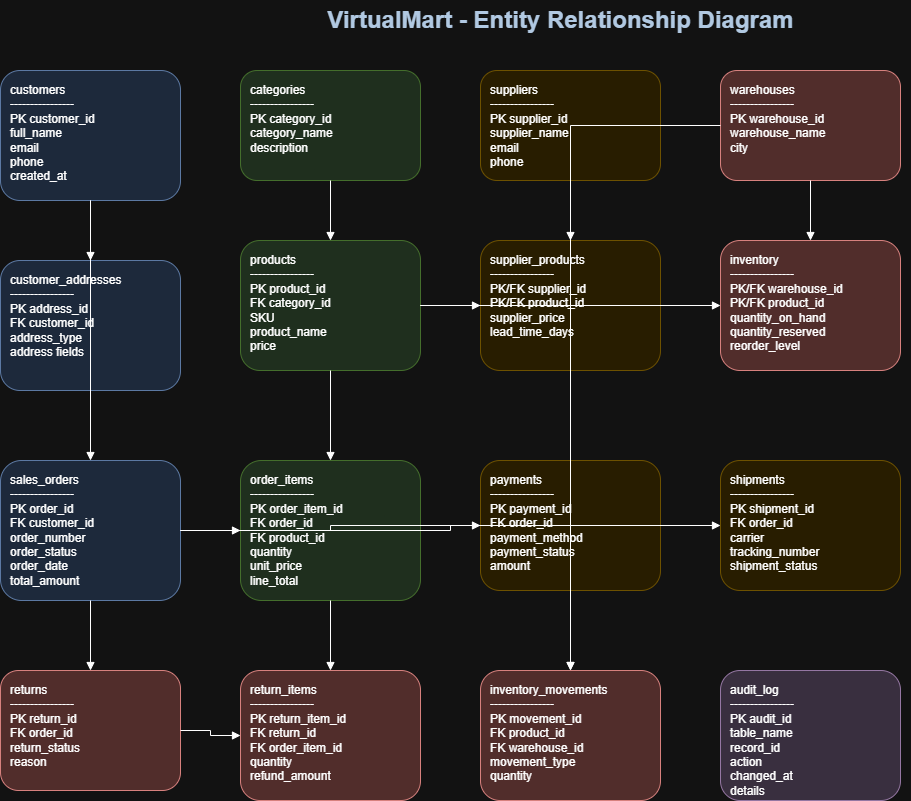

# VirtualMart — Database Modeling and Architecture Design

## Project Overview

VirtualMart is a fictional e-commerce database project built with PostgreSQL 18. It demonstrates relational data modeling, database architecture, integrity constraints, indexing, synthetic data loading, and analytical SQL queries.

The database models customers, addresses, products, categories, suppliers, warehouses, inventory, sales orders, payments, shipments, returns, and inventory movements.

**Project type:** Database design and SQL analytics  
**Database:** PostgreSQL 18  
**Database name:** `virtualmart_db`  
**Schema:** `virtualmart`  
**Environment:** Local development  
**Dataset:** Fictional synthetic demonstration data

## Objectives

- Design a relational database for a fictional e-commerce platform.
- Define primary keys, foreign keys, data types, and integrity constraints.
- Create indexes for common lookup and join operations.
- Load and validate synthetic sample data.
- Write analytical SQL queries for orders, products, customers, inventory, payments, shipments, suppliers, and daily sales.
- Document the database architecture using an entity-relationship diagram (ERD).

## Technology Stack

| Technology | Purpose |
|---|---|
| PostgreSQL 18 | Relational database engine |
| pgAdmin 4 | Database administration and SQL execution |
| Visual Studio Code | SQL development and documentation |
| diagrams.net | ERD design and export |
| Python | Local report generation |
| python-docx | Word report generation |

## Project Structure

```text
VirtualMart/
├── sql/
│   ├── 01_schema.sql
│   ├── 02_tables.sql
│   ├── 03_indexes.sql
│   ├── 04_sample_data.sql
│   └── 05_analytics.sql
├── diagrams/
│   ├── VirtualMart_ERD.drawio
│   └── VirtualMart_ERD.png
├── docs/
│   └── VirtualMart_Report.docx
├── scripts/
│   └── generate_report.py
├── .venv/
└── README.md
```

The `.venv/` directory contains the local Python environment used to generate the report. It is not required to run the PostgreSQL database scripts.

## Database Design

The project contains 16 tables:

| Table | Purpose |
|---|---|
| `customers` | Customer records |
| `customer_addresses` | Customer addresses |
| `categories` | Product categories |
| `suppliers` | Supplier records |
| `products` | Product catalogue |
| `supplier_products` | Supplier-product relationships |
| `warehouses` | Warehouse records |
| `inventory` | Stock levels by product and warehouse |
| `sales_orders` | Order headers and monetary totals |
| `order_items` | Products within each order |
| `payments` | Payment records and statuses |
| `shipments` | Shipment and tracking information |
| `returns` | Return records |
| `return_items` | Items associated with returns |
| `inventory_movements` | Inventory movement history |
| `audit_log` | Foundation for application-recorded audit events |

The schema uses relational keys and constraints to maintain data integrity. Monetary values use `NUMERIC` data types. Inventory is associated with both products and warehouses.

The `audit_log` table is currently a foundation only; automated audit triggers have not been implemented.

## Entity-Relationship Diagram

The editable diagram and exported image are available in the `diagrams/` directory.



Open `diagrams/VirtualMart_ERD.drawio` in diagrams.net to edit the diagram.

The ERD is a visual overview; the SQL scripts are the authoritative source for exact column definitions and constraints.

## Setup and Execution

### Prerequisites

- PostgreSQL 18
- pgAdmin 4 or another PostgreSQL client

### 1. Create the database

Create a database named `virtualmart_db` using pgAdmin or PostgreSQL tools.

### 2. Run the SQL scripts in order

Execute the following files against `virtualmart_db`, in the listed order:

1. `sql/01_schema.sql` — create and configure the schema.
2. `sql/02_tables.sql` — create the 16 tables.
3. `sql/03_indexes.sql` — create explicit indexes.
4. `sql/04_sample_data.sql` — insert synthetic sample records.
5. `sql/05_analytics.sql` — run analytical queries.

In pgAdmin, select `virtualmart_db`, open **Query Tool**, open the relevant SQL file, and execute it.

**Important:** `04_sample_data.sql` is intended for the initial data load. Do not run it repeatedly against the same populated database unless the script has been adapted to prevent duplicate records.

### 3. Verify the tables

Run this query:

```sql
SELECT
    table_name
FROM information_schema.tables
WHERE table_schema = 'virtualmart'
  AND table_type = 'BASE TABLE'
ORDER BY table_name;
```

The result should contain 16 tables.

## Analytical Queries

The `sql/05_analytics.sql` script includes 8 analytical queries:

1. Order counts and totals by order status.
2. Top-selling products by quantity and item revenue.
3. Customer order history, including customers without orders.
4. Inventory reorder alerts.
5. Payment monitoring by payment status and method.
6. Order shipment and tracking status.
7. Supplier coverage across products.
8. Daily order volume and value.

The inventory reorder query currently returns no rows because all sample inventory records are above their reorder thresholds. This is expected for the supplied dataset.

## Sample Dataset

The initial sample dataset contains 53 rows across the 16 tables. It includes fictional customers, products, suppliers, warehouses, orders, payments, shipments, inventory records, and inventory movements.

The sample data is small and intended for demonstration, not production-scale performance testing.

## Indexing and Integrity

The project defines 11 explicit indexes in `sql/03_indexes.sql`. PostgreSQL also creates indexes automatically for primary-key and unique constraints where applicable, so the total index count shown in pgAdmin can be higher.

Primary keys, foreign keys, unique constraints, and check constraints help maintain valid relationships and values. Production deployments would require further testing, security configuration, monitoring, and performance analysis.

## Security and Privacy

- Use only the fictional sample dataset provided with this project.
- Do not add real customer records or confidential business data.
- Do not store database passwords, personal API keys, or credentials in SQL scripts or documentation.
- Configure appropriate database permissions before sharing the project or deploying it.
- Keep local environment files and generated artifacts under review before committing the project to source control.

## Limitations and Future Improvements

- The current dataset is small and synthetic.
- The ERD is an overview and can be refined with more explicit relationship cardinalities.
- The `audit_log` table is not connected to automated auditing triggers.
- Return-related tables are defined but have no sample rows in the initial dataset.
- Performance has not been benchmarked against production-scale data.

Potential improvements include adding more test scenarios, automated integrity checks, controlled audit logging, query-plan analysis using `EXPLAIN ANALYZE`, and repeatable database validation scripts.

## Project Deliverables

- PostgreSQL schema and table definitions
- Indexing script
- Synthetic sample data
- Eight analytical SQL queries
- Editable ERD and PNG export
- Word project report

## Conclusion

VirtualMart demonstrates a practical database-development workflow, from relational modeling and schema creation to synthetic data loading, SQL analytics, and project documentation. It provides a foundation for further learning in SQL development and data analysis.